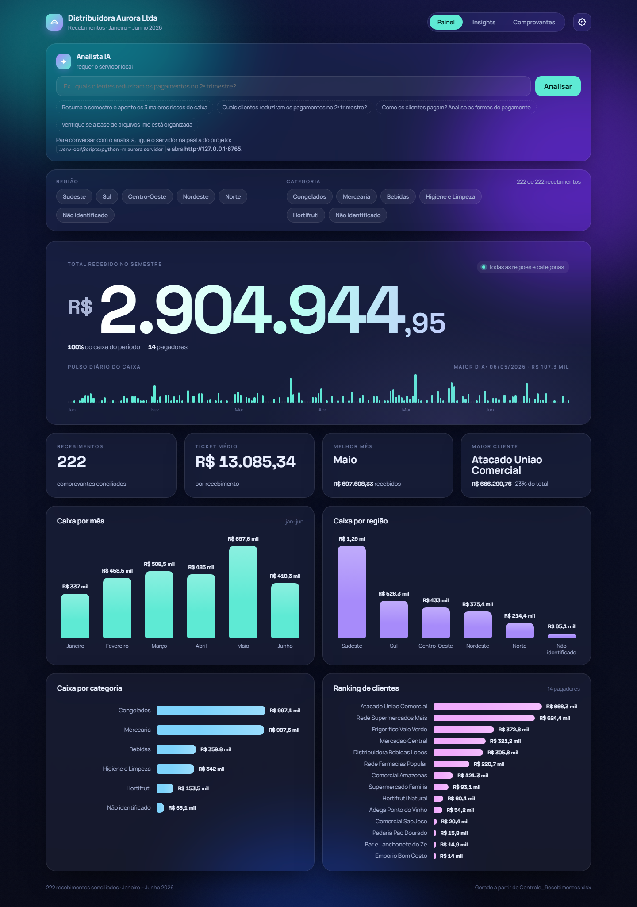
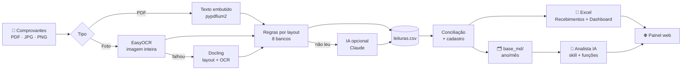
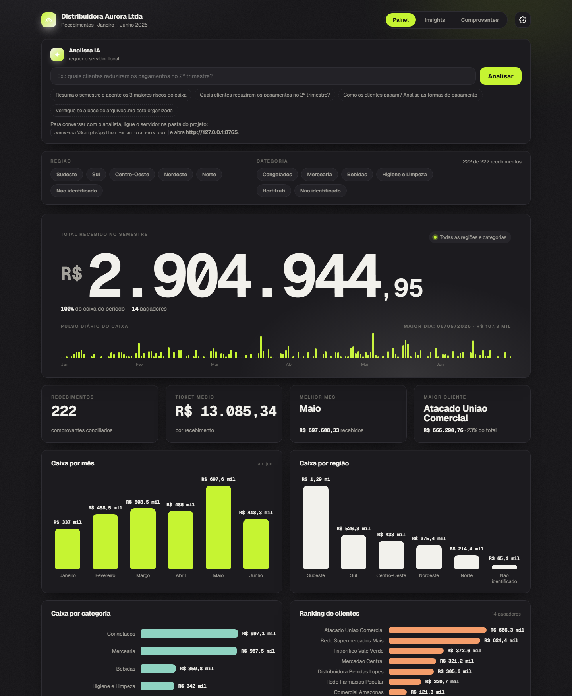
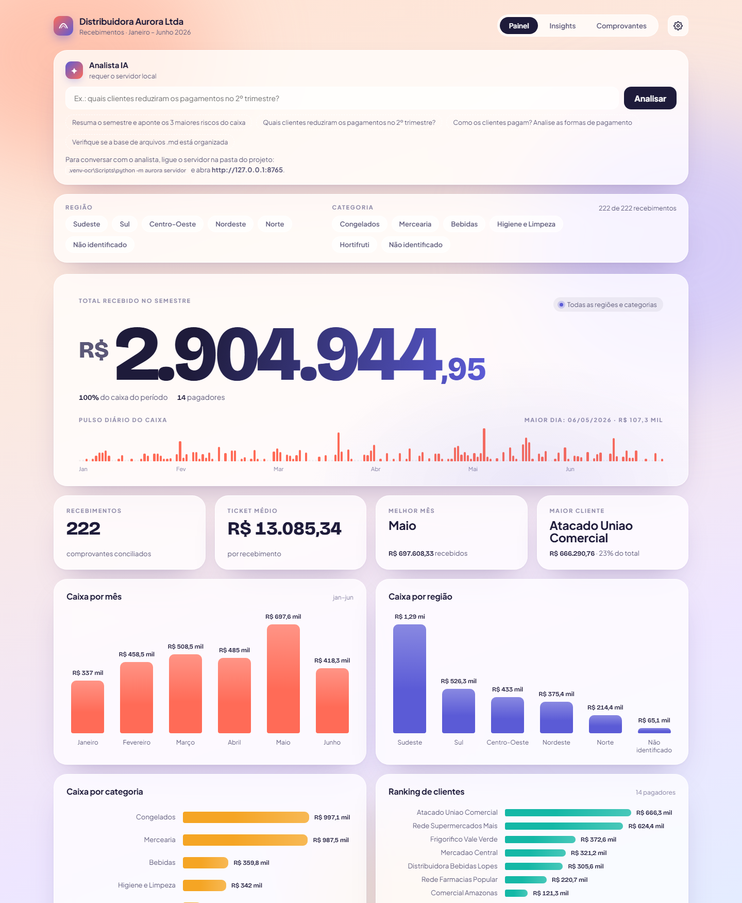
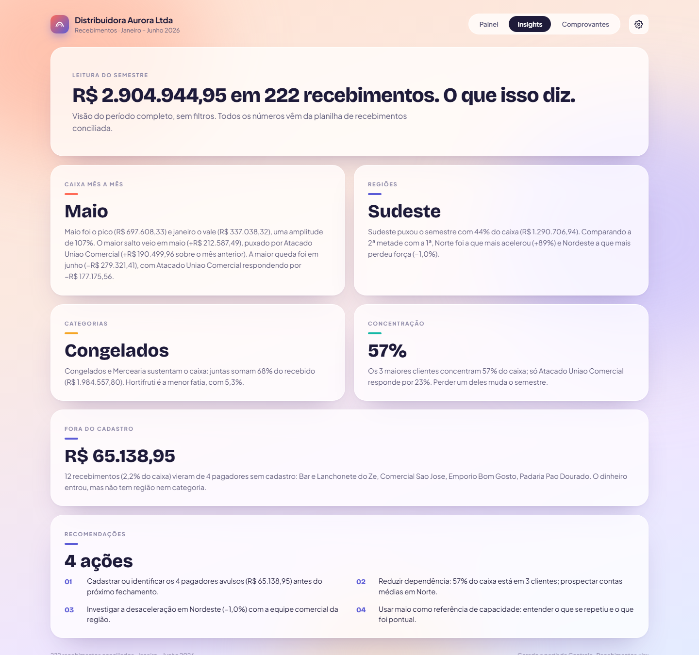
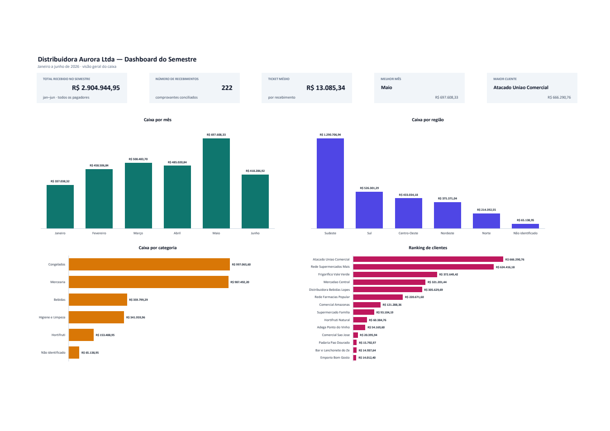
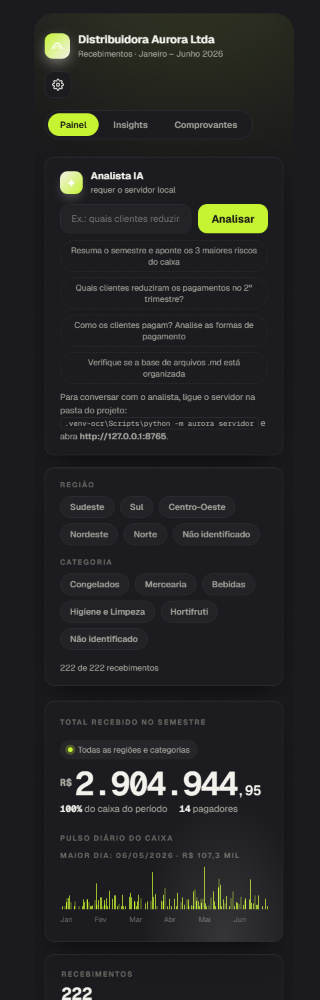

<div align="center">

# Business Panel · Aurora

**De uma pasta com 230 comprovantes bagunçados a um painel financeiro com IA — sem digitar uma linha.**

Leitura automática de comprovantes (PDF e fotos) · conciliação com cadastro · dashboard no Excel ·
painel web interativo · analista de IA que consulta os dados e cria suas próprias funções de negócio.


-D97757)




</div>

---

## Sumário

1. [O problema](#-o-problema)
2. [O que a aplicação faz](#-o-que-a-aplicação-faz)
3. [Resultados](#-resultados) · [Dados do caso incluídos](#️-dados-do-caso-incluídos)
4. [Arquitetura](#-arquitetura)
5. [Telas](#-telas)
6. [Como rodar](#-como-rodar)
7. [Analista de IA, skill e funções de negócio](#-analista-de-ia-skill-e-funções-de-negócio)
8. [Decisões técnicas e aprendizados](#-decisões-técnicas-e-aprendizados)
9. [Estrutura do projeto](#-estrutura-do-projeto)
10. [Segurança](#-segurança)
11. [Próximos passos](#-próximos-passos)

---

## 🧩 O problema

A **Distribuidora Aurora Ltda** (empresa fictícia) vende para o varejo e recebe de 10 clientes
por Pix, TED, transferência, boleto e depósito. Os comprovantes chegam por WhatsApp e e-mail e
caem todos numa pasta. Seis meses depois, ninguém sabe quanto entrou.

| O que dificulta | Na prática |
|---|---|
| **8 layouts de banco** | O mesmo campo aparece como *Pagador*, *Origem*, *Debitado de*, *Remetente*… ou sem rótulo nenhum |
| **5 formatos de arquivo** | PDF, JPG, JPEG, PNG — 40% são fotos e prints, sem texto por trás |
| **Armadilhas reais** | 6 reenvios duplicados, 2 fotos ilegíveis, 4 pagadores fora do cadastro, 6 nomes escritos de jeitos diferentes |
| **Regras sutis** | No e-mail, o "De:" é o banco, não o cliente · em extrato, o ano está no cabeçalho · "valor do documento" ≠ "valor pago" |

O desafio veio de um estudo de caso de automação financeira. Este repositório é a minha
implementação **em código**, ponta a ponta, mais as camadas extras de IA.

## ✨ O que a aplicação faz

| # | Etapa | O que acontece |
|---|---|---|
| 1 | **Leitura** | PDFs: texto embutido. Fotos: **EasyOCR** na imagem inteira → **Docling** se falhar → IA (opcional). Regras por layout extraem data, pagador, valor e forma — e **nunca chutam**: o que não dá para ler vai para revisão |
| 2 | **Organização** | Renomeia cada arquivo para `AAAA-MM-DD_Cliente_Valor.ext`, marca `_copia` nos reenvios e `ILEGIVEL_` no que precisa de conferência (com log para desfazer) |
| 3 | **Conciliação** | Casa o pagador com o cadastro (acentos, abreviações, razão social, erros de digitação) e preenche região/categoria. Pagador desconhecido **não** é forçado no mais parecido |
| 4 | **Dashboard Excel** | Aba com 5 KPIs e 4 gráficos, fórmulas vivas, moeda BR, uma página em paisagem |
| 5 | **Painel web** | HTML único, 3 temas, filtros cruzados, tooltips ricos, insights para diretoria e a lista navegável de todos os comprovantes |
| 6 | **Rotina semanal** | Toda segunda: detecta só os arquivos novos (pelo padrão de nome), lê, concilia e atualiza tudo |
| + | **Base Markdown** | `base_md/<ano>/<MM-mes>/` com um `.md` por comprovante e resumos por mês — leitura barata para a IA |
| + | **Analista de IA** | Chat no topo do painel que consulta os dados, gera análises, organiza os arquivos e **cria funções de negócio padronizadas** |

## 📊 Resultados

Validado contra o gabarito oficial do caso (222 pagamentos):

| Métrica | Resultado |
|---|---|
| Pagamentos lançados que batem com o gabarito | **210 de 210** (data, cliente, valor, forma, região e categoria) |
| Valores lançados errados | **0** |
| PDFs lidos corretamente | **138 de 138** |
| Fotos lidas automaticamente | **78 de 92** — o resto vai para revisão, sem inventar valor |
| Duplicados detectados | **6 de 6** |
| Pagadores fora do cadastro identificados | **4 de 4** |

### Comparativo de OCR (mesmos arquivos, mesmas regras, conferido com o gabarito)

| Motor | Fotos (92) | PDFs (16) | Tempo/foto |
|---|---|---|---|
| Docling (layout + EasyOCR) | 55 | 12 | 29 s |
| EasyOCR na imagem inteira | **61** | 8 | **20 s** |
| **Os dois combinados** | **77** | — | — |
| Texto embutido do PDF | — | **16** | < 0,1 s |

Os erros de um motor não são os do outro: combinados, sobem de ~63% para **84%** das fotos.
Daí a ordem adotada: **texto do PDF → EasyOCR → Docling → IA**.

## 🏗️ Arquitetura



O ponto de contato entre a leitura e o resto é um contrato simples
([`dados/LEITURAS_FORMATO.md`](dados/LEITURAS_FORMATO.md)): qualquer OCR que gere esse CSV
pluga no pipeline.

## 🖼️ Telas

<table>
<tr>
<td width="50%"><b>Tema Grafite & Lima</b><br></td>
<td width="50%"><b>Tema Amanhecer</b><br></td>
</tr>
<tr>
<td><b>Insights para a diretoria</b><br></td>
<td><b>Comprovantes identificados</b> — busca, filtro por situação e link para o original<br></td>
</tr>
<tr>
<td><b>Dashboard no Excel</b> — gerado e verificado no Excel real<br></td>
<td><b>Responsivo</b> — sem rolagem lateral, gráficos se reorganizam<br></td>
</tr>
</table>

> 💡 Depois de clonar, abra **[`Painel_Aurora.html`](Painel_Aurora.html)** no navegador: é o painel gerado com os
> **dados reais do caso** — filtros, temas (tecla <kbd>T</kbd>), tooltips e a aba Comprovantes com o botão "Abrir"
> levando a cada arquivo da pasta [`Comprovantes/`](Comprovantes). As capturas acima foram feitas com a
> demonstração fictícia ([`docs/painel-demo.html`](docs/painel-demo.html)).

**Destaques do painel:** o total é sempre o maior número da tela · filtros de região e categoria
desabilitam combinações sem dados (nunca leva a uma tela vazia) · o gráfico da dimensão filtrada
destaca em vez de sumir com as outras barras · tooltip do mês mostra os 5 maiores clientes ·
"pulso diário" com uma barra por dia do semestre.

## 🗃️ Dados do caso incluídos

O repositório traz o resultado completo do processamento dos 230 comprovantes do caso:

| Caminho | Conteúdo |
|---|---|
| [`Comprovantes/`](Comprovantes) | Os 230 arquivos originais, **já renomeados** pela etapa 2 (`AAAA-MM-DD_Cliente_Valor`, `_copia`, `ILEGIVEL_`) |
| [`Controle_Recebimentos.xlsx`](Controle_Recebimentos.xlsx) | Planilha conciliada: Recebimentos (210 linhas), Cadastro e Dashboard |
| [`Painel_Aurora.html`](Painel_Aurora.html) | Painel interativo gerado com esses dados |
| [`base_md/`](base_md) | Base Markdown por ano/mês, resumos e pendências |
| [`dados/leituras.csv`](dados/leituras.csv) | O que a leitura extraiu de cada arquivo (contrato da etapa 1) |
| [`dados/renomeacao_log.csv`](dados/renomeacao_log.csv) | Nome original → novo nome de cada comprovante |
| [`dados/ocr_md/`](dados/ocr_md) | Cache do texto lido (texto do PDF, EasyOCR e Docling) — permite reprocessar as regras sem refazer o OCR |
| [`dados/apelidos.csv`](dados/apelidos.csv) | Correções manuais de nome (razão social → cliente do cadastro) |

Para reprocessar tudo a partir desses dados: `python -m aurora tudo --aplicar`.

## 🚀 Como rodar

### 1. Demonstração rápida (sem OCR, ~1 minuto)

Gera 230 comprovantes **fictícios** com as mesmas armadilhas do caso e roda o pipeline inteiro:

```bash
git clone https://github.com/engcarlo/business-panel-aurora.git
cd business-panel-aurora
pip install -r requirements.txt

python -m aurora --base demo mock            # cria demo/ com dados fictícios
python -m aurora --base demo tudo --aplicar  # etapas 1 a 5 + base Markdown
```

Abra `demo/Painel_Aurora.html` e `demo/Controle_Recebimentos.xlsx`.

### 2. Com seus próprios comprovantes (OCR)

```bash
py -3.11 -m venv .venv-ocr
.venv-ocr\Scripts\pip install torch torchvision --index-url https://download.pytorch.org/whl/cpu
.venv-ocr\Scripts\pip install -r requirements-ocr.txt
```

1. Coloque os arquivos em `Comprovantes/` e a planilha (estrutura em `modelos/`) como `Controle_Recebimentos.xlsx`.
2. Leia: `.venv-ocr\Scripts\python -m aurora.ocr_docling --pasta Comprovantes --saida dados\leituras.csv`
3. Processe: `python -m aurora tudo --aplicar` (sem `--aplicar` a renomeação é só simulada).

### 3. Painel com o Analista de IA

```bash
.venv-ocr\Scripts\python -m aurora servidor     # abre http://127.0.0.1:8765
```

Em **⚙ Configurações › APIs de IA**, cadastre sua chave (fica só no seu computador) e pergunte no topo do painel.

### Todos os comandos

| Comando | O que faz |
|---|---|
| `python -m aurora lancar` | Etapa 1 — leituras → aba Recebimentos |
| `python -m aurora renomear [--aplicar]` | Etapa 2 — renomeia a pasta (simula por padrão) |
| `python -m aurora desfazer-renomeacao` | Volta os nomes originais pelo log |
| `python -m aurora cadastro` | Etapa 3 — região/categoria e padronização de nomes |
| `python -m aurora markdown` / `organizar` | Gera / reorganiza a base `base_md/<ano>/<MM-mes>/` |
| `python -m aurora dashboard` | Etapa 4 — aba Dashboard no Excel |
| `python -m aurora painel` | Etapa 5 — `Painel_Aurora.html` |
| `python -m aurora tudo [--aplicar]` | Etapas 1 a 5 em sequência |
| `python -m aurora semana` | Etapa 6 — rotina semanal (só arquivos novos) |
| `python -m aurora servidor` | Painel + chat de IA em `127.0.0.1` |
| `python -m aurora funcoes [--semear \| --executar NOME]` | Biblioteca de funções de negócio |

Qualquer comando aceita `--base PASTA` para rodar em outra pasta (ex.: `--base demo`).

## 🤖 Analista de IA, skill e funções de negócio

O chat do painel é guiado por uma **skill** em texto puro — [`skill_aurora/SKILL.md`](skill_aurora/SKILL.md),
no formato aberto de Agent Skills — e usa **ferramentas descritas em JSON Schema**. Nada disso é
específico de um fornecedor: trocar de provedor de IA é escrever um adaptador
(`ADAPTADORES` em [`aurora/chat.py`](aurora/chat.py)). O adaptador implementado é o da Anthropic (Claude).

**Como a IA trabalha**

- **Lê barato:** navega `README → resumo do ano → resumo do mês → comprovante`, em vez de reler 230 arquivos.
- **Não inventa número:** todo valor sai de uma ferramenta que calcula em Python.
- **Mantém a casa em ordem:** a skill obriga a manter os `.md` em `<ano>/<MM-mes>/`, nunca apagar, e salvar análises na pasta do mês.
- **Cria funções padronizadas:** quando um indicador não existe, ela escreve uma **página de função**
  (`skill_aurora/funcoes/<nome>.md`: quando usar, fórmula, parâmetros e código), que é **validada e
  testada com os dados reais antes de ser salva**. O [índice](skill_aurora/funcoes/_indice.md) se atualiza sozinho.

**Funções que já vêm na biblioteca**

| Categoria | Funções |
|---|---|
| Receita | `ticket_medio` |
| Clientes | `curva_abc_clientes` · `clientes_em_queda` · `recorrencia_clientes` |
| Concentração | `concentracao_receita` (top N + índice HHI) |
| Tendência | `variacao_mensal` · `comparar_periodos` · `sazonalidade_mensal` |
| Pagamentos | `mix_formas_pagamento` · `participacao_forma_por_categoria` *(criada pela própria IA)* |
| Previsão | `projecao_media_movel` |
| Qualidade | `qualidade_base` |

```text
$ python -m aurora funcoes --executar concentracao_receita
Top 3 clientes = 64,7% da receita. HHI = 0,171 (concentração moderada). Equivale a 5,9 clientes de mesmo tamanho.

$ python -m aurora funcoes --executar clientes_em_queda
5 cliente(s) com queda de 20% ou mais.
| cliente                 | período A      | período B      | queda   |
| Adega Ponto do Vinho    | R$ 514.581,99  | R$ 289.808,98  | -43,7%  |
| ...                                                                  |
```

## 🧠 Decisões técnicas e aprendizados

- **Medir antes de escolher.** O Docling era a escolha óbvia para OCR, mas o comparativo contra o
  gabarito mostrou que ele descarta como "figura" justamente o valor em letra grande dos apps de banco.
  Combinar motores rendeu mais do que trocar um pelo outro.
- **Nem todo PDF precisa de OCR.** Os 138 PDFs tinham texto embutido: ler direto é exato e 45× mais rápido.
- **Regras primeiro, IA no fim.** Regras por layout são determinísticas, testáveis e gratuitas; a IA
  entra só no que sobra. Cada leitor só aceita um valor quando o encontra de forma inequívoca —
  por exemplo, o total do cupom PagLesto é conferido pela conta `valor doc − desconto + juros`.
- **Errar para o lado seguro.** Nome com uma palavra só (corte do OCR) ou valor que pode ser a hora
  ("13.53.40") são recusados. Resultado: zero valores errados lançados.
- **Estado nos próprios arquivos.** A rotina semanal sabe o que é novo pelo padrão de nome — não
  depende de memória nem de banco de dados.
- **Contrato entre camadas.** O CSV de leituras isola o OCR do resto: dá para trocar o leitor sem tocar no pipeline.
- **Front-end sem dependências.** Um único HTML com gráficos em CSS/SVG próprios: abre offline, sem build.

## 📁 Estrutura do projeto

```text
business-panel-aurora/
├── aurora/                  # pacote Python (python -m aurora ...)
│   ├── ocr_docling.py       #   leitura: texto do PDF → EasyOCR → Docling → IA
│   ├── extrator.py          #   regras dos 8 layouts de banco
│   ├── extrator_ia.py       #   camada de IA da leitura (opcional)
│   ├── leituras.py          #   contrato leituras.csv + detecção de duplicados
│   ├── nomes.py             #   casamento pagador ↔ cadastro
│   ├── etapas_dados.py      #   etapas 1, 2 e 3
│   ├── dashboard.py         #   etapa 4 (Excel)
│   ├── painel.py            #   etapa 5 (dados + insights) · painel_template.html (visual)
│   ├── base_md.py           #   base Markdown ano/mês
│   ├── rotina.py            #   etapa 6 (segunda-feira)
│   ├── servidor.py          #   servidor local 127.0.0.1
│   ├── chat.py              #   ferramentas neutras + adaptadores de provedor
│   ├── ia_config.py         #   cadastro das APIs
│   ├── funcoes.py           #   motor da biblioteca de funções (execução protegida)
│   └── mock.py              #   gerador de dados fictícios
├── skill_aurora/
│   ├── SKILL.md             # skill do analista (independente de provedor)
│   └── funcoes/             # uma página .md por função + _indice.md
├── Comprovantes/            # os 230 comprovantes do caso, já renomeados
├── base_md/                 # base Markdown ano/mês (lida pelo Analista IA)
├── dados/                   # leituras.csv, log de renomeação, cache de OCR, apelidos
├── Controle_Recebimentos.xlsx · Painel_Aurora.html   # resultados finais
├── modelos/                 # planilha modelo vazia (estrutura do caso)
├── docs/                    # imagens e painel de demonstração
├── ROTINA_SEGUNDA.md        # instruções da rotina semanal
└── requirements*.txt
```

## 🔒 Segurança

- O servidor escuta **só em 127.0.0.1**, recusa requisições de outros sites e só serve `Comprovantes/` e `base_md/`.
- Chaves de API ficam em `dados/config_ia.json` (ignorado pelo Git) e chegam ao navegador sempre mascaradas.
- As ferramentas da IA não saem da `base_md/` (tentativas com `../` são recusadas) e não apagam arquivos.
- O código das funções de negócio roda **sem `import`, sem acesso a arquivos ou rede, sem atributos internos,
  com `range` limitado e tempo máximo** — e é testado antes de ser salvo. Oito tentativas de ataque
  (ler a chave, escapar do ambiente, laço infinito…) foram recusadas nos testes.

## 🛣️ Próximos passos

- [ ] Adaptadores para outros provedores de IA (o formato das ferramentas já é neutro)
- [ ] Fila de revisão no painel para os comprovantes `ILEGIVEL_`
- [ ] Testes automatizados (pytest) cobrindo os 8 layouts e a execução protegida
- [ ] Empacotar como app desktop (servidor + painel num executável)

---

<div align="center">

Feito por **Carlo Yukio** · caso baseado em material didático de automação financeira
(empresa, clientes e comprovantes são fictícios).

</div>
